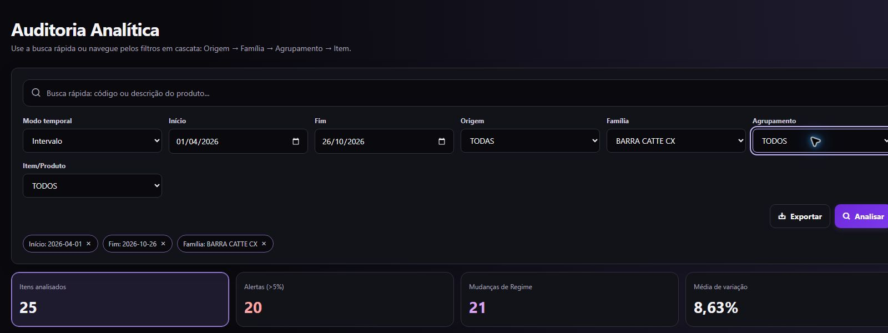

# Agrupamento na cascata de Custos — CUS-AGR-01 / PERF-03

Verificação em **30/10/2026** no checkout local e Supabase Custos-Germani (`umpebdovrazzrdndhigc`). Somente SELECTs pelo conector e consultas da aplicação autenticada; nenhuma importação, classificação ou escrita de dados remotos, migration, RLS/Auth, commit, push ou deploy. Login realizado pelo humano, sem captura de credenciais.

## Resultado e causa do sintoma atual

O catálogo não está vazio. **Nenhum produto com histórico de custos possui `agrupamento_cod` preenchido.** Por isso a filtragem de categorias aplicáveis em `getMasters()` retorna zero grupos; não existe perda posterior de agrupamentos preenchidos nessa fotografia. Selecionar Família não pode criar vínculos ausentes.

SELECTs atuais encontraram:

- 6.113 produtos em `dicionario_produtos`.
- Um produto com `agrupamento_cod` preenchido e um código distinto; uma correspondência em `categorias_agrupamento`.
- Único vínculo: `TESTE123` → `SEM_AGRUPAMENTO`, rótulo “Sem agrupamento (pendente de categorização)”; esse produto não possui custos.
- 34 registros em `categorias_agrupamento`.
- 2.481 fatos de custos e 447 códigos distintos, todos encontrados no operacional; competências entre 01/04/2026 e 26/10/2026.
- Entre esses 447: zero com agrupamento preenchido, zero códigos distintos de agrupamento e zero correspondências aplicáveis no catálogo.
- UI publicada e build local autenticados exibiram **12 origens, 37 famílias, zero agrupamentos e 447 produtos**, desconsiderando as opções TODAS/TODOS. O achado histórico 12/37/0 foi revalidado, sem presumir sua causa.

Consulta de contagem utilizada, somente leitura:

```sql
with custos as (
  select distinct codigo_produto from public.historico_custos
), base as (
  select d.*, c.codigo_produto is not null as tem_custo,
         a.id as agrupamento_resolvido
  from public.dicionario_produtos d
  left join custos c using (codigo_produto)
  left join public.categorias_agrupamento a on a.id = d.agrupamento_cod
)
select count(*) as produtos_operacionais,
       count(*) filter (where nullif(trim(agrupamento_cod), '') is not null) as com_agrupamento,
       count(distinct agrupamento_cod) filter (where nullif(trim(agrupamento_cod), '') is not null) as agrupamentos_distintos,
       count(*) filter (where agrupamento_resolvido is not null) as produtos_com_correspondencia,
       count(distinct agrupamento_resolvido) as grupos_com_correspondencia,
       count(*) filter (where tem_custo) as produtos_com_custo,
       count(*) filter (where tem_custo and nullif(trim(agrupamento_cod), '') is not null) as custos_com_agrupamento,
       count(distinct agrupamento_cod) filter (where tem_custo and nullif(trim(agrupamento_cod), '') is not null) as grupos_em_custos,
       count(*) filter (where tem_custo and agrupamento_resolvido is not null) as custos_com_correspondencia,
       (select count(*) from public.categorias_agrupamento) as catalogo_total,
       (select count(*) from custos) as custos_distintos
from base;
```

SELECT separado confirmou o único vínculo e a ausência de custos; `information_schema.columns` confirmou que o catálogo tem `id`, `descricao`, `abreviatura`, todos TEXT. **Não há `codigo` separado nem UUID de agrupamento nesse catálogo.** O `id` contém o código de negócio. A normalização existente da API prioriza `codigo` quando presente em outro formato de catálogo, senão a referência existente. Não foi necessário alterar esse contrato nem o schema.

## Rastreamento das camadas

1. **Operacional e catálogo:** existem categorias, mas nenhum vínculo nos produtos de Custos. Não usar os agrupamentos ERP opcionais para preencher os nulos.
2. **`getMasters()`:** lê fatos/dimensões integralmente em páginas de 500/count exact; projeta apenas códigos com custos e filtra o catálogo pelos seus `agrupamento_cod`. O único código preenchido é excluído corretamente por não ter custos. Não há cache nessa API.
3. **Classificação/enriquecimento:** `classificarCustos()` mantém Agrupamento do operacional; origem/família ERP permanecem com autoridade conforme CUSTOS-ERP-01. Nenhuma mudança nesse núcleo.
4. **Hierarquia:** `mapHierarchyRows()` preserva `agrupamento_cod`; os 447 vínculos atuais ficam null. Fixtures comprovam também o transporte de valores preenchidos.
5. **Estado/UI:** `loadMasters()` armazena as coleções e `refreshCascade()` usa a hierarquia e o catálogo; código é valor da opção, descrição é rótulo. `fillSelect` conserva apenas seleção válida. Categoria solta/sem catálogo não produz opção fictícia.
6. **Relatório e consumidores:** `getHistorico`/comparações filtram o código depois do enriquecimento. Relatório/KPIs/gráfico temporal usam o histórico filtrado; exportador usa `state.reportRows`. Nenhuma mudança de alerta, prioridade, ordenação ou TOP-200.
7. **Cache:** havia defeito independente comprovado: chave dependia dos filtros e somente da quantidade da hierarquia. Mudança de vínculo/rótulo com mesmo tamanho retornava opções antigas, inclusive entre objetos diferentes. Fallback dicionário e catálogos/produtos também eram ignorados.

## Correções e comportamento antes/depois

- **Cache:** antes reutilizava classificação/rótulo antigo; agora compara fotografia estruturada dos campos efetivamente consumidos. Hierarquia/fallback, vínculos, códigos/rótulos e produtos participam. Conteúdo igual reutiliza referência; conteúdo diferente invalida com a mesma cardinalidade. Tuplas JSON evitam colisão por delimitadores; sem hash com colisão presumida, revisão externa, I/O ou consultas por linha. A comparação é O(n) sobre esses campos.
- **Reload/realtime:** antes o callback realtime apenas repopulava selects de masters antigos; agora relê masters completos quando recebe evento das fontes já assinadas. Fontes/publicação Supabase não foram alteradas; não houve evento produtivo fabricado para teste. O ciclo geral de cache/carregamento de masters permanece PERF-02.
- **Reset de grupo:** antes um grupo inválido voltava a TODOS no select, mas os produtos podiam continuar filtrados pelo valor removido; agora o cálculo usa o grupo efetivamente aceito nessa mesma atualização. Família/Origem conservam seus resets existentes e produto inválido cai para TODOS.
- **Drill-through:** antes um produto excluído pelo novo recorte podia continuar aberto, pois a atualização recebia apenas competências; agora recebe os códigos elegíveis do relatório completo e fecha quando o produto sai. Histórico dos elegíveis conserva produto e competências, sem nova semântica temporal.
- **Recorte vazio/exportação:** antes a saída antecipada escondia o relatório, mas mantinha `reportRows` antigo disponível ao exportador; agora limpa esse estado e invalida o histórico aberto. O próprio exportador existente bloqueia arquivo sem análise. Nenhuma alteração em `ui-export.js`.

## Testes e qualidade

Antes da correção funcional, os novos testes reproduziram **sete falhas**: seis por cache obsoleto e uma por produtos calculados com grupo removido. Depois passaram.

- `tests/report-engine-cascade.test.js`: 11 testes — conteúdo idêntico, reclassificação com mesmo tamanho, fallback dicionário, rótulos de família/grupo/produto, reload, códigos distintos com rótulo igual, categoria sem vínculo e vínculo sem catálogo.
- `tests/ui-filters.test.js`: 15 testes — resets por Origem/Família/Agrupamento, opções recalculadas, produto invalidado, reload do grupo removido e regressões de filtros rápidos/ordenação.
- `tests/api-custos-pagination.test.js`: 42 testes — API/projeção/hierarquia, exclusão de categoria sem custos, código versus ID técnico/rótulo, grupo específico e TODOS, relatório/KPIs, comparações/gráficos, drill-through e XLSX, paginação/autoridade ERP/falha explícita.
- `tests/ui-drill-through.test.js`: 19 testes — histórico temporal preservado e fechamento do produto excluído, inclusive recorte vazio.
- `tests/ui-controller-cascade.test.js`: 3 testes — mesmo grupo nos consumidores, fonte XLSX limpa em recorte vazio e recarga de masters no callback realtime.
- **Específicos: 90/90** nos cinco arquivos acima. **23 novos testes** no total.
- **Suíte completa: 990/990, 52 arquivos**, com `node node_modules/vitest/vitest.mjs run --maxWorkers=2 --reporter=dot`.
- Lint: `node node_modules/eslint/bin/eslint.js .` — passou, zero avisos.
- Typecheck: `node node_modules/typescript/bin/tsc --noEmit -p jsconfig.json` — passou.
- Build: `scripts/build-web.mjs` — passou com a configuração pública do site, validando o hostname do projeto e mantendo segredos fora de dist. A primeira tentativa com o arquivo local de valores vazios falhou corretamente; não foi tratada como sucesso nem exigiu editar configuração rastreada.
- `git diff --check`: passou; links locais dos nove documentos e imagem conferidos, com 20 itens ativos no backlog após encerrar PERF-03 localmente.

Fixtures de teste são locais e explícitas; não são evidência de classificação existente na produção. Não foi fabricado cenário no banco nem na UI autenticada.

## Validação visual real

Chrome, build local em `http://127.0.0.1:4173/`, sessão autenticada pelo humano, código servido de `dist`; período 01/04/2026–26/10/2026. A publicação foi consultada somente para comparação inicial e configuração pública; não houve deploy.

1. Sem Família: 447 produtos e Agrupamento apenas TODOS.
2. Família **BARRA CATTE CX**: 25 produtos/opções aplicáveis; Agrupamento aberto/conferido, somente TODOS.
3. Produto **3748664** selecionado: KPI de itens passou a 1.
4. Família **ALFAJOR CX**: Produto foi resetado para TODOS; 2 produtos/opções e KPI 2; Agrupamento continuou TODOS.
5. Família **TODAS**: universo e KPI retornaram a 447.
6. Selecionada Família e depois Origem **BISCOITO PRODUZIDO CX**: Família resetada para TODAS, Agrupamento/Produto para TODOS; 4 famílias, 59 produtos/opções e KPI 59.



**Limitação obrigatória:** nenhuma Família do universo atual possui agrupamento operacional preenchido. Portanto, os passos de selecionar um agrupamento real, analisar sua redução e voltar a TODOS, assim como remover uma seleção real de grupo ao trocar Família, **não puderam ser certificados visualmente com dados de produção**. Esses comportamentos positivos passaram nos testes locais. Não declarar validação produtiva integral do Agrupamento, nem preencher dados para satisfazê-la. Realtime produtivo também não foi provocado por escrita.

## Achado separado e limites preservados

O console local registrou `OperationalContractError: Falha ao carregar o cadastro mestre de produtos` em `getProductMaster` → `ui-product-master.reload` durante a carga inicial. O relatório de Custos carregou normalmente depois do login. O erro de Cadastro foi registrado separadamente, sem atribuir causa remota, alterar RLS/Auth ou corrigir outro módulo nesta execução. O aviso de categorização que orienta usar Supabase já pertence a CAD-UX-02 e não foi alterado.

`data_referencia` permanece competência; `criado_em` evento/importação. Classificação atual não é histórico de classificação. OP/OP×CUSTO, parsers/importadores, schema/migrations/RLS/Auth, dados remotos, alerta ≥5%, prioridade, TOP-200 e formato/ordenação do XLSX preservados. ROADMAP não recebeu alteração: não houve mudança de capacidade futura ou decisão de produto, apenas correção/diagnóstico do contrato existente.

Documentos atualizados: README, AGENTS, backlog, matriz, relacionamentos/cascata e os três manuais. Código funcional em `core/report-engine.js`, `view/ui-filters.js`, `view/ui-controller.js`, `view/ui-drill-through.js`; testes nos cinco arquivos listados acima. A API foi investigada e testada sem alteração funcional.
